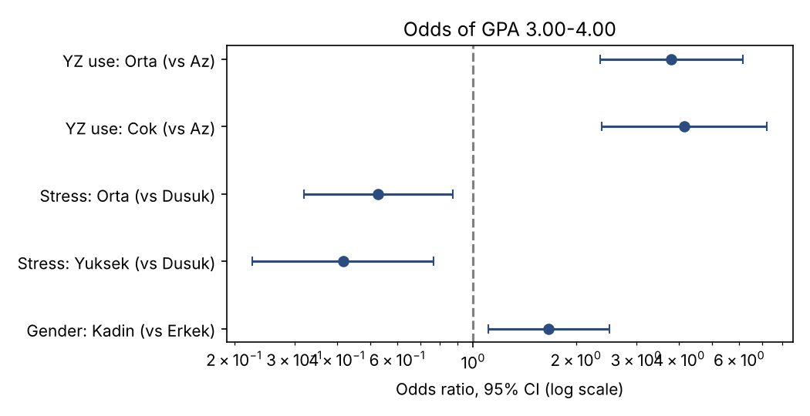
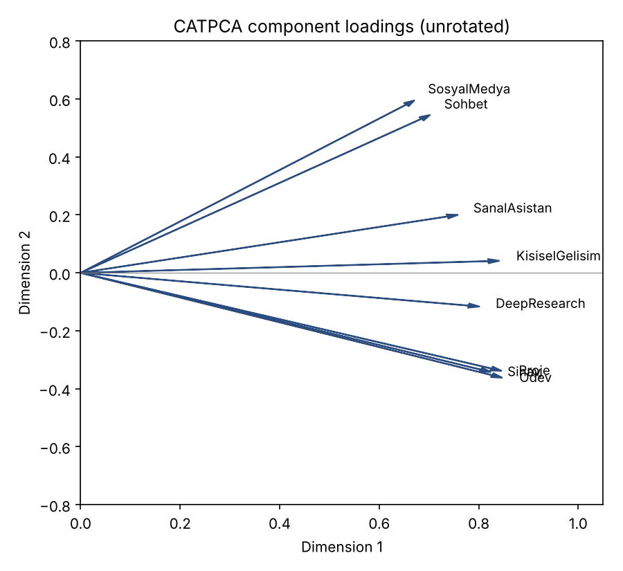

# Generative-AI use, stress and academic success: logistic regression and CATPCA

Python replication of two analyses from my final project for **IST646 Multivariate Statistical Methods** (M.Sc. Statistics, Hacettepe University). The original work was done in IBM SPSS 29. The question: how are generative-AI use, stress and gender related to a student's academic success, and what usage profiles sit behind eight ways of using AI?

The survey data come from a group project (Gümüş, Özdemir, İsmayilzada, Baysağ & Şenel, 2025) and are **not included**; see [`data/README.md`](data/README.md) for the required file layout.

## What is in the repo

| Part | Method | Python |
|---|---|---|
| 1 | Binary logistic regression for GPA 3.00-4.00 (predictors: AI use, stress, gender) with omnibus test, Cox-Snell / Nagelkerke R², Hosmer-Lemeshow, classification table and odds ratios | `statsmodels` |
| 2 | Categorical PCA (ordinal optimal scaling) of eight AI-use items with oblimin rotation | own implementation (alternating least squares + isotonic regression) |

The report also contains a third part, a review of an article on multidimensional scaling (İbicioğlu, 2012). It is a literature review, not an analysis, so it is not replicated.

## Results (N = 489)

**Logistic regression** (reference: AI use = Az, stress = Düşük, gender = Erkek)

| Term | B | Exp(B) | 95% CI | p |
|---|---|---|---|---|
| AI use: Orta | 1.335 | 3.80 | 2.35 - 6.14 | <0.001 |
| AI use: Çok | 1.420 | 4.14 | 2.37 - 7.22 | <0.001 |
| Stress: Orta | -0.639 | 0.53 | 0.32 - 0.87 | 0.012 |
| Stress: Yüksek | -0.877 | 0.42 | 0.23 - 0.76 | 0.005 |
| Gender: Kadın | 0.508 | 1.66 | 1.11 - 2.50 | 0.014 |

Omnibus χ²(5) = 76.57 (p < 0.001), −2LL = 558.89, Cox-Snell R² = 0.145, Nagelkerke R² = 0.199, accuracy 67.3%.

**CATPCA** — two dimensions with eigenvalues 4.99 and 1.07 (75.7% of variance, Cronbach's α = 0.954). After oblimin rotation (dimension correlation 0.54) the items split into a *study / academic* profile (homework, project, exam preparation, deep research, personal development) and a *social / leisure* profile (social-media content, chat, virtual assistant).




## Agreement with SPSS

| Quantity | SPSS | Python |
|---|---|---|
| Logistic coefficients, Wald, Exp(B), CI | see report | identical to 3 decimals |
| −2LL / Cox-Snell / Nagelkerke | 558.891 / .145 / .199 | 558.891 / .145 / .199 |
| Accuracy | 67.3% | 67.3% |
| CATPCA eigenvalues | 4.985, 1.071 | 4.986, 1.070 |
| CATPCA total α | .954 | .954 |
| Unrotated loadings (e.g. Ödev) | .847, −.363 | .848, −.362 |
| Oblimin dimension correlation | .539 | .539 |
| Hosmer-Lemeshow χ²(8) | 6.056 (p = .641) | 6.124 (p = .633) |

The small Hosmer-Lemeshow difference comes from how tied predicted probabilities are split into groups. Everything else agrees to the reported precision, though differences in the last digit are possible because CATPCA is iterative and SPSS and this code use different optimizers.

## Run it

```bash
pip install -r requirements.txt
python src/analysis.py data/survey.sav
```

Tables are written to `results/` and figures to `figures/`.

## Files

- `src/analysis.py` — full analysis
- `results/` — coefficient, model-summary, classification, eigenvalue, loading and correlation tables
- `report/IST646_Final_Presentation_TR.pdf` — original presentation (Turkish, SPSS output)

## Limitations

The study is a cross-sectional survey at one campus, so the associations are not causal. AI use and GPA may influence each other, and self-reported usage and stress levels are subjective. The 67.3% accuracy is on the training data.

## License

MIT, see [`LICENSE`](LICENSE).
